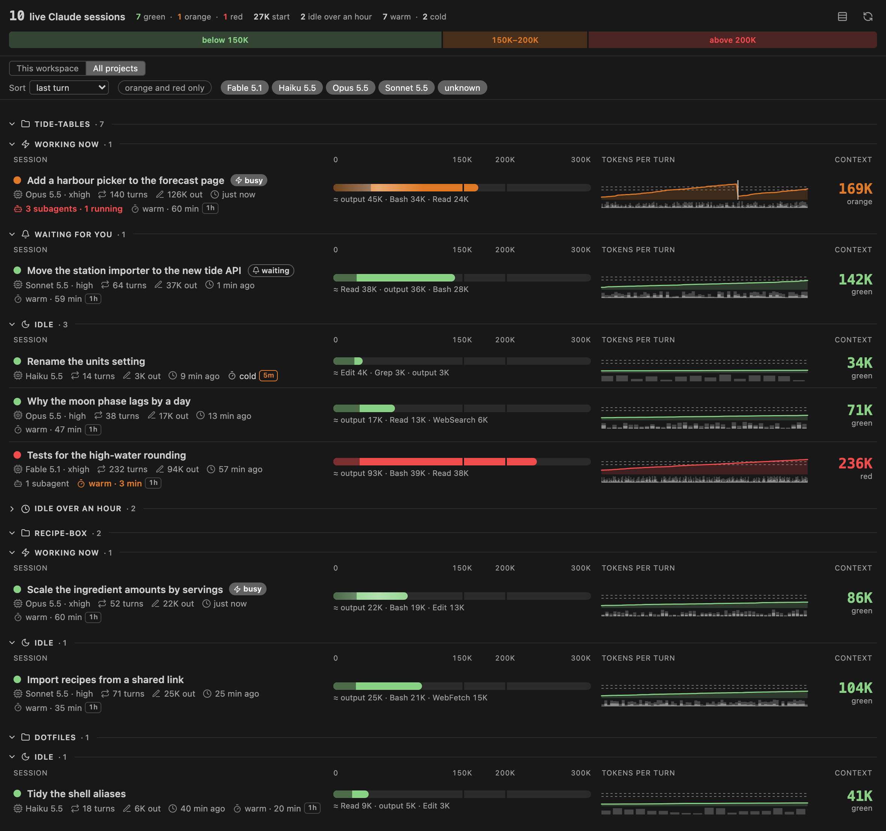
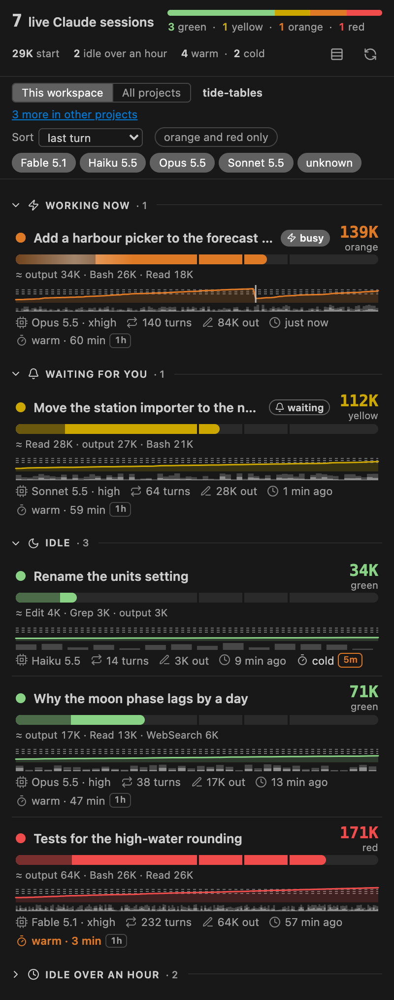
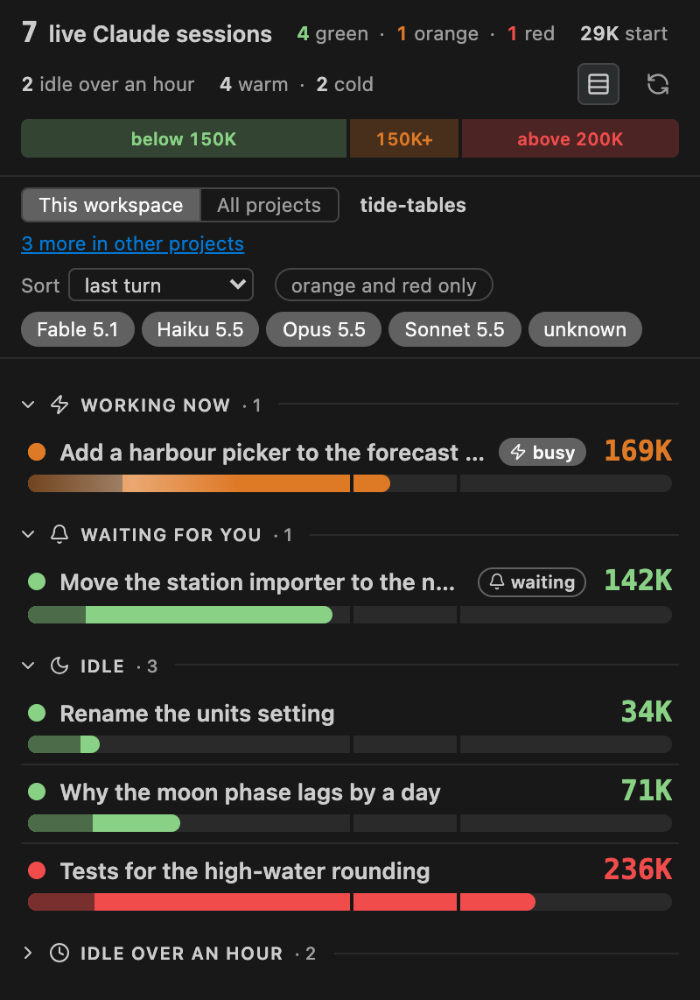
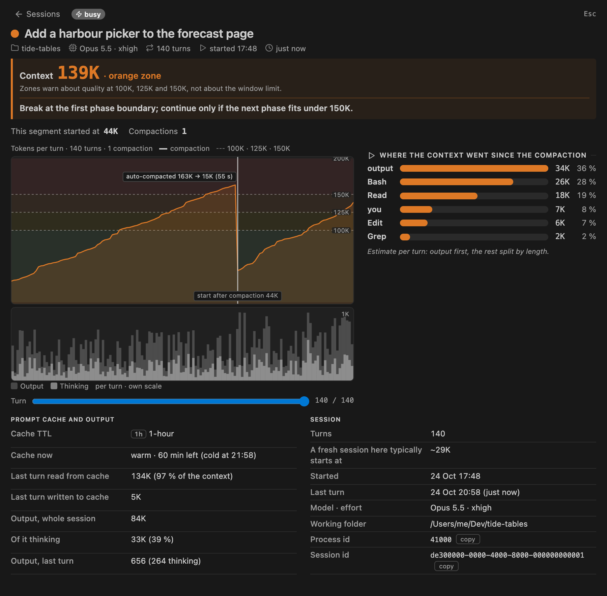

<div align="center">

<picture>
  <source media="(prefers-color-scheme: dark)" srcset="media/icon-dark.svg">
  
</picture>

# Claude Context

A VS Code panel that shows the context window of every live Claude Code session on the machine, updated
in real time. The same panel runs in a browser tab too, for Claude Code in a terminal, JetBrains or the desktop app.

[](https://github.com/frodemathiass1/claude-context-vscode/actions/workflows/test.yml)


[](LICENSE)

</div>



<sub>Every screenshot here is made from invented sessions (`scripts/demo.cjs`), not from real conversations, in VS Code's
Dark Modern theme; the panel follows whatever theme the editor has, and in a browser the system's light or dark setting.</sub>

## Why

A long session gets worse well before it hits the window limit: past a certain size the model starts to lose track
of what is in its context. Matt Pocock calls this the dumb zone: his smart zone lasts "~150k tokens on
state-of-the-art models". The panel shows every live session's token count against that mark and a second of its
own at 200K, deeper into the dumb zone, where the context went since the session started, and when its prompt cache goes cold, so you can see when it is time to break a session and which one.

> [!NOTE]
> The panel reads Claude Code's own files on this machine. It never calls an API and sends nothing anywhere.

## Install

There are two ways to run the panel, and neither needs the other: as a VS Code extension in the sidebar, or as a
page in a browser tab served by a small local server, for Claude Code in a terminal, JetBrains or the desktop app.
Both read the same files and show the same panel; use either or both. Without VS Code, go straight to
[In a browser](#in-a-browser).

### In VS Code

You need VS Code 1.131 or newer and Claude Code running on the same machine (any backend: Anthropic, Amazon
Bedrock, Vertex AI). The extension is not on the Marketplace; VS Code loads it straight from a cloned folder.
All commands below are run from the Command Palette: Ctrl+Shift+P (Cmd+Shift+P on macOS), type the command name
and press Enter.

1. Clone the repo to a folder that stays put (VS Code loads the extension from it on every start):

   ```
   git clone https://github.com/frodemathiass1/claude-context-vscode
   ```

   For example `C:\Develop\claude-context-vscode` on Windows or `~/Dev/claude-context-vscode` on macOS.
2. Command Palette → **Developer: Install Extension from Location…** → pick the cloned folder (the one
   with `package.json` in it).
3. Command Palette → **Developer: Reload Window**.

To update, run `git pull` in the clone, then **Developer: Reload Window**. To uninstall, go to **Extensions: Show
Installed Extensions** → Claude Context → **Uninstall**, then delete the clone.

### In a browser

No VS Code needed: you need Node.js 18 or newer, Git, and Claude Code running on the same machine.

To try it, one command in a terminal fetches the repo from GitHub and starts the server:

```
npx github:frodemathiass1/claude-context-vscode
```

For regular use, clone the repo once and start the server from the clone:

```
git clone https://github.com/frodemathiass1/claude-context-vscode
cd claude-context-vscode
node server.cjs
```

Either way it prints a URL and opens it in the default browser. The server runs as long as its terminal does;
Ctrl+C stops it. The URL carries a token that is new on every start (see the note below), so start the server
when you want the panel rather than at login, and use the URL it prints.

To update a clone, run `git pull` and start the server again. npx may run the copy it fetched the first time; to
be sure of the latest, delete npx's cache (`~/.npm/_npx`, or `%LocalAppData%\npm-cache\_npx` on Windows) first.
To uninstall, delete the clone: nothing else is installed.

The flags, the same for both:

```
node server.cjs [folder…] [--port <n>] [--claude-dir <dir>] [--no-open]
```

- **folder…**: the folders that make up "This workspace", as the open folders do in VS Code. With none, the
  list is every live session on the machine.
- **--port**: the port on `127.0.0.1`. It is 7419 unless that one is taken, so the page's choices last from one
  start to the next (see below); `--port 0` takes any free one.
- **--claude-dir**: the folder Claude Code stores its data in, as the `claudeContext.claudeDir` setting does in VS
  Code. Without it, `CLAUDE_CONFIG_DIR`, else `~/.claude`.
- **--no-open**: print the URL without opening it.

What differs from VS Code:

- The scope switch, the view, the folds and the open session are kept in the browser's `localStorage`, not in VS
  Code. They belong to the address, port included, so a server on another port starts afresh. Each tab has its
  own scope.
- The theme follows the system's light or dark setting, in the colours of VS Code's Light Modern and Dark Modern
  themes, and a browser tab is usually wide enough for the four columns.
- When the server stops, the page keeps its last list and says that it has lost the connection; a page that never
  reached the server (opened from an earlier start, say) says the same over an empty list.

> [!NOTE]
> The server listens on `127.0.0.1` only, so no other machine can reach it. The URL carries a random token made at
> every start, as Jupyter's does, and the server refuses any request without it, so another page open in the
> same browser cannot read your sessions either. It also refuses a request that names another host (DNS
> rebinding) and a message from another origin, and sends no CORS headers. After a restart, open the new URL.

## Open the panel

In a browser, the panel is the page `server.cjs` opens. In VS Code:

- Click the **Claude Context** icon (a clock) in the activity bar, the vertical icon bar on the far left.
  With many icons it may sit behind **…** at the end of the bar; right-click the bar to choose which icons
  it shows.
- Or: Command Palette → **Claude Context: Focus on Claude sessions View** (type `Claude sessions`). **View: Open View…**
  followed by `Claude sessions` does the same.

If neither the icon nor the command shows up, the window was not reloaded after the install: run
**Developer: Reload Window**. **Extensions: Show Installed Extensions** should list "Claude Context".

To keep the panel visible next to the file explorer or the Claude Code chat, drag the icon to the other
side of the window, or right-click it → **Move To** → **Secondary Side Bar**.

## A tour

<p align="center">
  
  &nbsp;
  
</p>

In the sidebar the panel is a list of the sessions in this window's workspace, grouped by what they are doing:
working now, waiting for you, idle, and idle over an hour (folded). Each row has the count in its zone colour, a
context bar with marks at 150K and 200K, an estimate of where the context went, a sparkline of tokens per
turn, and the state of the prompt cache. **All projects** shows the whole machine instead, grouped by project,
and from 620 px wide the rows spread over four columns, as in the image at the top.

The button beside refresh (three stacked bars) switches to compact rows: each session is only its title line,
with the busy or waiting pill and the count, and the context bar under it, so many more fit in the sidebar. The
panel remembers the choice.



Click a row (or press Enter on it) to open the session's detail view: what the zone means and what to do at the
next phase boundary, the whole curve with every compaction, where the context went, and the prompt cache.

## What the panel shows

### Zones

Every session is in one of three zones by its token count: green below 150K, orange up to 200K, red above. The
zones are absolute token counts, not a share of the model's window: they follow Matt Pocock's smart zone and
dumb zone as he gives them in 2026. He has two zones with a gradual decline between them. Green is his smart
zone, up to his newest figure, "~150k tokens on state-of-the-art models"; orange is the start of the dumb zone.
His dictionary's earlier figure, that the dumb zone "commonly begins around 125K-150K tokens — though this is
debated", is the same boundary, so the panel draws no line of its own for it. Red above 200K is the panel's own
line: he gives no figure for how deep the dumb zone goes, and he and the published measurements describe a
gradual decline, not a cliff. The zones warn about quality, not about the window limit. The header draws them,
so the limits are in view before any row.

The bars and curves run 0–300K, past the red line, so the red band has room on the scale and few sessions run
off the end; a count above 300K fills its bar, with a hatched end.

### Header

The count of live sessions and how many are in each zone; the warm and cold prompt
caches; the median start of the sessions that began fresh, so a CLAUDE.md that grew shows at a glance; and
"3 idle over an hour" when there are such sessions. While a filter hides sessions it says "showing 4 of 10".
At the right end, the compact switch and the refresh button: refresh reads the registry and every transcript
again from the first byte, and says "updated 12:04:31" when done. Click it when you doubt what the list shows,
for example right after a process was ended.

Across the bottom of the header, the zone scale: a strip as wide as the header that stands for 0–300K, the same
scale as the row bars, each zone a band at its true width with its range written inside ("below 150K",
"150K–200K", "above 200K"; "<150K", "150K+", ">200K" when a band is too narrow, and no text when even that does
not fit), so the limits are in view before any row. Point at a band for what to do at the next phase boundary in that zone.

### Groups

The sessions sit under four group headings, in this order:

- **Working now**: busy sessions, whose dot pulses.
- **Waiting for you**: a session that waits for a permission prompt, a question or a dialog, with an
  outlined "waiting" pill that does not move. It is never hidden or folded away, however long it has waited.
- **Idle**: the rest. A session with no turn for more than an hour is dimmed.
- **Idle over an hour**: a session that is neither busy nor waiting and had neither a turn nor its process
  start for an hour (an empty one by its start alone), folded until you open it. VS Code keeps a chat tab's
  process running after the tab is closed, until **Developer: Reload Window**, and nothing tells a closed tab
  from an open one (`NOTES.md`, "Closed chat tabs"), so most of these are probably closed tabs.

Every group heading (and, with all projects, each project) folds and unfolds on a click, keeping its count;
the panel remembers which are folded.

### A row

One row per session:

- The title, and the count in the zone colour with the zone's name under it.
- A context bar scaled 0–300K with marks at 150K and 200K; its tooltip says what to do at the next
  phase boundary in the orange and red zones. Its first part, in a muted shade, is the start of the
  session: the first turn, which holds the fixed load (CLAUDE.md, memory, skill and tool listings) and the
  first message ("start 29K · conversation 87K"; after a compaction it starts again at the first turn after it).
- Under the bar, an estimate of where the conversation's growth went ("≈ Bash 50K · output 46K · Read 27K"):
  per turn, what the model wrote first, the rest split by length over the tool results, your messages and
  attachments; every source in the tooltip.
- A sparkline of tokens per turn, with a solid mark at every compaction Claude Code recorded (the tooltip says
  whether it was automatic and the count before and after) and a dotted one at any other sharp drop (a
  `/clear` starts a new transcript, so it starts a new curve). Thin bars under it show the output tokens per
  turn, the thinking part drawn stronger.
- The model with the effort of the last turn ("Opus 5.5 · xhigh"), the number of turns, the output tokens of
  the session ("44K out"; the tooltip has the last turn and the thinking share) and the time since the last turn.
- The prompt cache: "warm · 47 min" counts down to the moment the cache goes cold (the last turn plus the TTL
  Claude Code chose, shown as a 1h or 5m pill; a drop to 5m is marked). A few minutes before that the text
  turns orange, and afterwards it says "cold". The tooltip has the deadline, how much of the last turn's
  context was read from cache and how much was written.
- Only when the session has subagents: "3 subagents · 1 running". A subagent has a context window of its own,
  so its tokens never count in the session's; the mark turns orange or red when the largest of them is in that
  zone, and its tooltip names it ("largest: Explore "Find the slow query" at 236K, red zone"). A session that
  waits on a running subagent shows that here, though the session itself looks quiet.

The rows stack in the narrow sidebar and spread over four columns when the panel is 620 px or wider.

### Controls

The control row under the header starts with the scope switch, which says what the list, and every counter
above it, is about: "This workspace" (the default, the sessions inside the window's workspace folders, or in the
browser the folders given to `server.cjs`, named beside the switch, with "4 more in other projects" when other
projects have live sessions; a click shows them) or "All projects" (the whole machine, grouped by project). Then the sort, which orders the rows inside each
group (last turn, context size, time until cold, started, title; rows without a value go last), and the
filters on the two idle groups: show only the orange and red zones, or switch a model off with its chip. A busy
or waiting session is never hidden; the header keeps counting everything, a group heading says "4 of 9" while
a filter is on, and "reset" puts the view back. The view is remembered like the folds.

### Detail view

The detail view opens in the list's place:

- The title, project, model and effort, turns, start and last turn.
- A box edged in the zone colour that says what the number is ("Context 169K · orange zone"), that the zones
  warn about quality at 150K and 200K and not about the window limit, and, in orange and red, what to do at the
  next phase boundary ("Break at the next phase boundary; continue only if the next phase needs this one
  verbatim."). Under it the named facts: "Session started at 29K" (or "This segment started at 44K"
  after a compaction) and "Compactions 1" when there was one.
- A large curve of tokens per turn over the whole session, with the three zone bands, the limits labelled on its
  axis (only 200K when a long session stretches the scale so far that 150K would overlap it), every compaction
  labelled with its trigger and counts, and the segment's start. Under it, in a field half its height on the same
  turns, the output per turn with its thinking part, on its own scale with the largest value in the corner.
  Hovering a turn in either field, or moving the "Turn" slider under them from the keyboard, shows its count,
  the change from the turn before, and its output and thinking.
- Beside the curve (under it when narrow), where the context went since the segment's start: one bar per
  source, largest first, with one short line on how it is estimated (the whole of it in the tooltip).
- Two tables: the prompt cache and output, and the session (what a fresh session here typically starts at,
  from the header's start median; working folder, process id and session id with a copy button).
- When the session has subagents, a table of them: one line each, running first and then by last turn, with its
  status, type and the description of its call, its own context on a small bar with the rows' scale and zones,
  turns, output, model and last turn. One sentence says why it is separate: what returns to the session is the
  subagent's report, counted under "Agent" in where the context went. "Running" means Claude Code has not
  recorded its end and it was written since the session's process started; "finished", that the end is
  recorded; "unknown", neither (a subagent cut off with an earlier process, as in a resumed session). A
  background subagent that wakes again after its end stays "finished" for those turns: Claude Code does not take
  its end back.

The list carries the last 200 turns of each session; the detail view asks the host for all of them, and says
"last 200 of 233 turns" only if the host cannot answer. The view follows the live list, says so if the
session leaves the registry, and goes back to the list on Escape or the back button; the panel remembers the
open session.

## Settings

- `claudeContext.claudeDir`: the folder Claude Code stores its data in. Empty (the default) means
  `CLAUDE_CONFIG_DIR`, else `~/.claude`. Set it when the panel says "Registry folder not found", for example
  because `CLAUDE_CONFIG_DIR` is set in your shell profile but VS Code was started without it. The panel
  reads from the new folder as soon as the setting changes. In the browser, `--claude-dir` does the same.

## Windows and Amazon Bedrock

Both work without configuration (checked on Windows 11 with Claude Code 2.1.304 on Bedrock). Sessions in a
subfolder of the workspace, such as git worktrees under `.claude\worktrees\`, count as the window's and are
named after their own folder. Bedrock transcripts carry the same model names and token fields as the
Anthropic API.

## Privacy

The title of a session is its AI-generated title or, before there is one, the start of its first message,
or the first local command when only that ran ("/context all"). A session without any of these, such as a tab
opened and not written to, is "new session" with the name Claude Code gave it ("new session ·
my-project-08"), muted, and says "no turns yet" with "—" for the count.

> [!WARNING]
> The panel shows titles only on this machine, but they can contain whatever was typed. Keep that in mind when
> you share your screen.

## How it works

Claude Code keeps one small file per running process in `~/.claude/sessions/` and the transcript of
every session in `~/.claude/projects/<project>/<sessionId>.jsonl` (`~/.claude` is `%USERPROFILE%\.claude`
on Windows; `CLAUDE_CONFIG_DIR` moves it), with each subagent's transcript and a small meta file in
`<sessionId>/subagents/` beside it. The extension joins them, parses only the new bytes of a
transcript on every change (`fs.watch` on the folders, debounced, plus a 30-second tick) and pushes the
list to the webview; it reads again at once when a workspace folder is added or removed, and reads nothing while
the panel is hidden (shown again, one read catches up). In the browser, `server.cjs` does the same and pushes the list to the page with
Server-Sent Events; the page sends its messages back as `POST` requests. The webview updates the rows, the
header's counters and the open session's view in place rather than rebuilding them, so a tooltip stays open while
lists come in, and it builds again only the rows whose content changed. While a session is open, the list behind it
rests, and the webview asks for every turn of the session after each list (the
message `{ type: "detail", sessionId }`); the host answers from the state it already parsed, without
reading the transcript again, and the view is drawn once, with that answer.

The transcript format is Claude Code's internal one and can change between versions. A field the panel
cannot find shows as "unknown"; nothing throws.

## Development

No dependencies, no build step: `core.cjs` (the pure functions, and the reader and watcher of Claude Code's
files), `panel.html` (the panel), and its two hosts, `extension.js` (VS Code) and `server.cjs` (the browser, with
Node's own `http`; it also holds the browser stand-in for the webview that the demo uses).

```
npm install
npm test                        # Vitest; the same suite runs on Ubuntu and Windows in GitHub Actions
node scripts/demo.cjs --shoot   # the screenshots above, from invented sessions, with a headless Chrome
```

Without `--shoot` the script writes `demo/light.html` and `demo/dark.html`, the panel with invented sessions,
to open in a browser. `NOTES.md` holds the facts measured about Claude Code's files; `CLAUDE.md` is how the
repo is worked on.

## License

MIT, see `LICENSE`.
